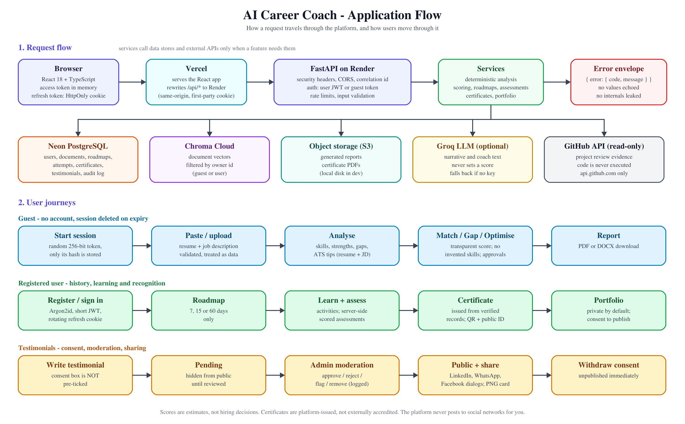

# AI Career Coach

A career-development platform built from an earlier Streamlit RAG prototype: resume and job-description
analysis, match scoring, skill gaps, resume optimisation, interview practice, an AI career coach, learning
roadmaps with assessments, certificates, a career achievement portfolio, and testimonials with moderation.

**Stack:** React 18 + TypeScript + Vite + Tailwind - FastAPI + SQLAlchemy 2 + Alembic + PostgreSQL -
LangChain/LangGraph - Groq (optional) - ChromaDB - Docker Compose. Target hosting: Vercel, Render, Neon,
Chroma Cloud (see [docs/deployment.md](docs/deployment.md)).



## What you can do
**Without an account (guest session, auto-deleted on expiry):** resume analysis, job description analysis,
resume/job match, skill gap analysis, resume optimisation, with PDF/DOCX reports.

**With an account:** everything above with saved history, plus interview preparation and mock interviews, the
AI Career Coach (grounded in your documents), learning roadmaps of **7, 15 or 60 days**, assessments,
GitHub project review, platform certificates with public verification, a consent-gated public portfolio,
ratings and testimonials, and (for admins) a dashboard and moderation.

## Design principles
- **Deterministic where it matters.** Scores, skill extraction, gaps, roadmaps and assessments are computed by
  auditable code. The LLM only writes optional narrative and coach answers and never sets a number.
- **Nothing is invented.** The optimiser never adds skills or experience you did not state; significant
  changes need your approval. The portfolio is built only from verified platform records.
- **Consent first.** Testimonials and portfolios are private by default; public display needs explicit
  consent, can be withdrawn at any time, and withdrawal takes effect immediately. Sharing offers
  LinkedIn, WhatsApp and Facebook share dialogs only; the platform never posts for you.
- **Untrusted input.** Uploaded files are validated (type, magic bytes, size, page and archive limits) and
  treated as data; prompt-injection text is flagged and never obeyed. Resume text, passwords and tokens are
  never logged.

## Quick start (local)
Prerequisites: Python 3.11+, Node 22, and (optional) Docker.

```bash
# Backend
cd backend
python -m venv .venv && .venv/Scripts/activate        # macOS/Linux: source .venv/bin/activate
pip install -r requirements-dev.txt
cp ../.env.example .env                                # edit locally; .env is git-ignored
alembic upgrade head
uvicorn app.main:app --reload                          # http://127.0.0.1:8000/docs
```

```bash
# Frontend (second terminal)
cd frontend
npm install
npm run dev                                            # http://localhost:5173
```

With no `GROQ_API_KEY` the app still works (deterministic features, grounded fallbacks). For quick local runs
set `EMBEDDING_PROVIDER=hash` (lexical retrieval; no model download) and a `JWT_SECRET_KEY` of 32+ characters.
For real embeddings install `requirements-local-embeddings.txt` and use `EMBEDDING_PROVIDER=local-hf`.

Everything at once: `docker compose up --build` (PostgreSQL, Chroma, API with migrations, frontend).

Create an administrator (there is no public way to get admin rights):

```bash
cd backend && ADMIN_PASSWORD="<strong password>" python ../scripts/create_admin.py you@example.com "Your Name"
```

## Tests and checks
| What | Command | Where |
|---|---|---|
| Backend tests + coverage | `python -m pytest --cov=app` | `backend/` |
| Lint and types | `python -m ruff check app tests` and `python -m mypy app` | `backend/` |
| Frontend unit tests | `npm test` | `frontend/` |
| Frontend types + build | `npm run build` | `frontend/` |
| End to end (Playwright, uses installed Edge) | `npm run e2e` | `frontend/` |

See [docs/testing.md](docs/testing.md) for what is and is not covered.

## Configuration
Every setting is an environment variable with a placeholder in [.env.example](.env.example). Secrets are
`SecretStr` values and are never logged or returned. The only variable the browser sees is `VITE_API_BASE_URL`.

## Documentation
[architecture](docs/architecture.md) - [database](docs/database_design.md) - [RAG pipeline](docs/rag_pipeline.md) -
[guest access](docs/guest_access.md) - [authentication](docs/authentication.md) -
[career intelligence](docs/career_intelligence.md) - [interview and coach](docs/interview_and_coach.md) -
[learning and assessments](docs/learning_and_assessments.md) -
[certificates and projects](docs/certificates_and_projects.md) - [portfolio](docs/portfolio.md) -
[feedback and testimonials](docs/feedback_and_testimonials.md) - [admin dashboard](docs/admin_dashboard.md) -
[testing](docs/testing.md) - [deployment](docs/deployment.md) -
[delivery report](docs/delivery_report.md) - [original project analysis](docs/existing_project_analysis.md) -
[migration plan](docs/migration_plan.md)

## Known limitations
Read [docs/delivery_report.md](docs/delivery_report.md) for the complete, honest list. In short: no live
PostgreSQL, Groq, GitHub, Chroma Cloud or object-storage run has been performed; interview feedback and project
review are heuristic/static; there is no OCR for scanned PDFs; rate limiting is in-process (single instance).
